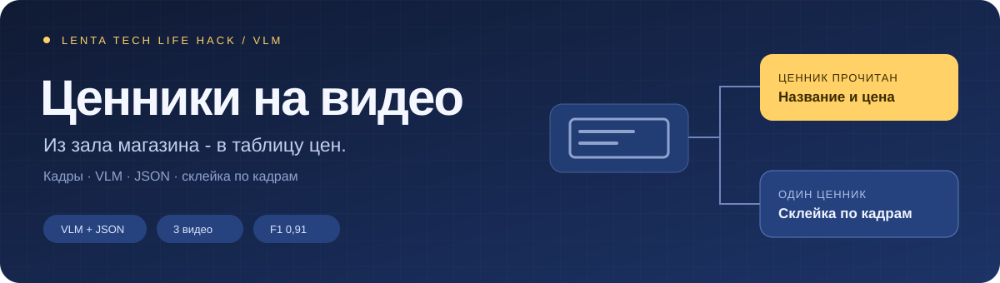

<p align="center">
  
</p>

<p align="center">
  <a href="#результаты">Результаты</a> ·
  <a href="#как-это-работает">Как это работает</a> ·
  <a href="#как-запустить">Запуск</a> ·
  <a href="docs/diploma.pdf">Диплом</a>
</p>

# Ценники на видео

**Автоматическое распознавание ценников на видео из торгового зала и перевод данных о товарах и ценах в таблицу.**

Решение для хакатона Lenta Tech Life Hack (первый тур). На вход подаётся видео, снятое в магазине. На выходе получается таблица: для каждого ценника название товара, цена, старая цена, цена за единицу и штрихкод.

### Пример формата

VLM получает кадр и возвращает ценники в виде JSON:

```json
[
  {
    "name": "Название товара",
    "price": 89.9,
    "old_price": null,
    "unit_price": null,
    "unit": "",
    "barcode": ""
  }
]
```

Поля, которые на ценнике не видны, остаются пустыми: модели запрещено додумывать значения.

```text
Видео
  |
Отбор кадров (1 кадр в секунду, без размытых)
  |
VLM читает ценники и возвращает JSON
  |
Склейка одного ценника по кадрам (голосование по полям)
  |
Таблица ценников: CSV и JSON
```

**Стек:** Python · OpenCV · VLM (OpenAI-совместимый API) · PyYAML

## Результаты

Решение проверено на 3 тестовых видео.

| Метрика | Значение |
|---|---:|
| F1 по ценникам | **0,91** |
| Precision | 0,91 |
| Recall | 0,92 |
| Точность цены | 0,89 |
| Полное совпадение полей (цена, старая цена, штрихкод) | 0,81 |
| CER названия | 0,15 |

F1, Precision и Recall считаются по уникальным ценникам в видео. CER (Character Error Rate) показывает долю ошибочных символов в названии: чем ближе к 0, тем лучше. Код метрик: [`src/pricetags/metrics.py`](src/pricetags/metrics.py).

## Как это работает

1. **Отбор кадров** ([`video.py`](src/pricetags/video.py)). Из видео берётся один кадр в секунду. Размытые кадры отбрасываются по дисперсии лапласиана, потому что на смазанном кадре цифры читаются плохо.
2. **Чтение ценников** ([`vlm.py`](src/pricetags/vlm.py)). VLM получает кадр и промпт с жёсткой JSON-схемой. Если поле не читается, модель оставляет его пустым. Битый ответ даёт пустой список, а не ошибку.
3. **Склейка по кадрам** ([`aggregate.py`](src/pricetags/aggregate.py)). Один ценник виден на многих кадрах. Наблюдения объединяются по штрихкоду или похожему названию, а цена, старая цена и штрихкод выбираются голосованием. Ценники, замеченные один раз, отсеиваются как шум.
4. **Выгрузка** ([`pipeline.py`](src/pricetags/pipeline.py)). Для каждого видео создаются `outputs/<видео>.csv` и `outputs/<видео>.json`.

Подход на VLM заменяет цепочку «детектор + OCR + правила разбора»: не нужно обучать детектор и вручную разбирать нестандартные ценники.

## Как запустить

```bash
python -m venv .venv && source .venv/bin/activate
pip install -r requirements.txt
```

1. Положите видео в `data/videos/`.
2. Поднимите VLM с OpenAI-совместимым API (например, vLLM) и укажите `base_url` и `model` в [`configs/default.yaml`](configs/default.yaml). Для облачного API задайте ключ: `export VLM_API_KEY=...`.
3. Запустите:

```bash
python scripts/run.py
python scripts/evaluate.py     # если есть разметка в data/annotations
```

Формат разметки `data/annotations/<видео>.json`:

```json
{"video": "shelf_01.mp4", "tags": [{"name": "...", "price": 89.9, "old_price": null, "barcode": ""}]}
```

## Структура

```text
assets/banner.svg        баннер
configs/default.yaml     параметры кадров, VLM и склейки
data/videos/             входные видео
data/annotations/        эталонная разметка для оценки
docs/diploma.pdf         диплом участника
scripts/run.py           прогон пайплайна
scripts/evaluate.py      подсчёт метрик
src/pricetags/           модули пайплайна
```
